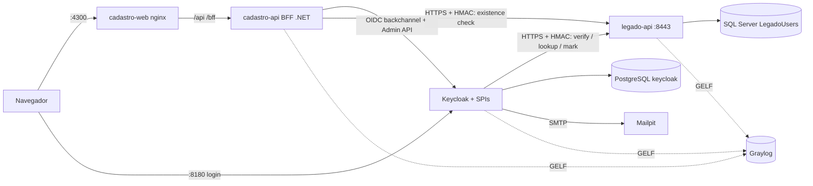
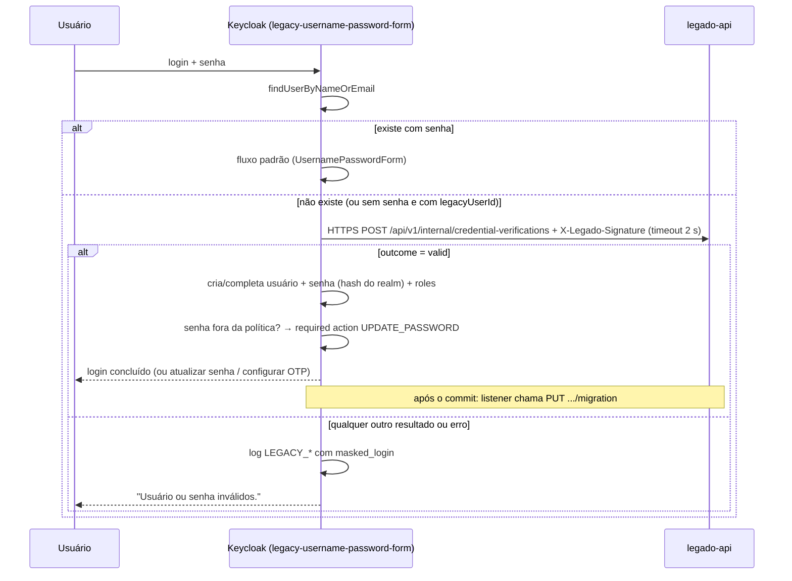

# Plano técnico — Spec 001 Cadastro com Keycloak e migração sob demanda do Legado

## 0. Conformidade com a Constituição

| Artigo | Status | Observação |
|---|---|---|
| I — Idioma | ✅ | Código, rotas, atributos do User Profile e eventos em inglês; comentários e docs em PT-BR |
| II — Simplicidade | ✅ | Cadastro sem banco próprio (dados no Keycloak); SPI sem novas bibliotecas; sessão do BFF em memória (ADR-0001 do cadastro) |
| III — Arquitetura | ✅ | Keycloak fala com o Legado **por API**, nunca pelo banco (Art. III.4); dependência só do novo para o Legado (o Legado não conhece Keycloak nem Cadastro); Cadastro em Clean Architecture |
| IV — Segurança | ⚠️ | Keycloak + BFF; canal interno com **TLS + assinatura HMAC** emitidos pelo Legado. **Exceção controlada**: identificador mascarado nos logs da SPI, contrariando a regra "nunca username/e-mail" do ADR-0002 do keycloak → ADR-0007 do keycloak |
| V — Testes | ✅ | Cada tarefa inclui testes; JUnit + `keycloak-test-framework`, xUnit v3 + Testcontainers, Vitest, Playwright |
| VI — Observabilidade | ✅ | Eventos de migração no Graylog com `trace_id`; streams e alertas novos |
| VII — Confiabilidade | ✅ | Timeout de 2 s, sem retry no login (usuário esperando), marcação idempotente após commit, criação concorrente tratada |
| VIII — Dados | ✅ | Legado: colunas novas anuláveis (expand), migration versionada; datas UTC |
| IX — Contratos | ✅ | `/api/v1/...` com OpenAPI e ProblemDetails, inclusive os endpoints internos do Legado |
| X/XI — Fluxo e conduta | ✅ | Branch `DEV-NNN` por repositório; PRs pequenos por tarefa |

## 1. Visão da solução

O **Cadastro** é um BFF ASP.NET Core + Angular. O BFF faz o login OIDC (Authorization Code + PKCE, client
confidencial `cadastro`), guarda os tokens no servidor e entrega ao navegador só o cookie `__Host-cadastro`.
Os dados do usuário ficam no **User Profile do Keycloak**, lidos e gravados pela Admin API com a conta de
serviço do próprio client.

No **Keycloak**, dois authenticators (SPI `Authenticator`) substituem os passos padrão nos fluxos copiados:
`legacy-username-password-form` no login e `legacy-reset-choose-user` no reset. Quando o usuário não está no
Keycloak, eles chamam o **Legado** (`LegacyUserClient`, HTTPS com requisição assinada por HMAC). Um event listener
(`legacy-migration-completion`) avisa o Legado depois que o usuário passa a ter senha no Keycloak.

O **Legado** ganha endpoints internos (`/api/v1/internal/...`) que validam credenciais com o próprio Identity,
consultam usuários e marcam a migração. Eles só existem numa porta HTTPS interna (`8443`), exigem assinatura HMAC com
chave **emitida pelo próprio Legado** para cada sistema chamador e ficam fora do nginx público.

**Independência do Legado (regra de desenho)**: a dependência aponta só de quem é novo para o Legado. O Legado não
conhece o Keycloak nem o Cadastro (nenhum emissor, JWKS, URL ou health check deles); chaves HMAC e certificado TLS são
gerados pelo Legado e entregues aos chamadores. `docker compose up` no Legado continua subindo sozinho, sem a porta
interna; a integração só liga com o override `docker-compose.identity.yml`.

| Desligado | Efeito |
|---|---|
| Keycloak | Legado funciona normalmente; Cadastro fica sem login |
| Legado | Keycloak segue; quem já migrou entra; quem não migrou recebe a mensagem genérica + `LEGACY_UNAVAILABLE`; cadastro no Cadastro responde 503 |
| Cadastro | Keycloak e Legado não são afetados |



Rede Docker compartilhada **`workspace-identity`**, declarada como `external` em todos os projetos e criada por um
script idempotente presente em cada repositório (`scripts/identity-network.sh`): nenhum projeto depende de outro
estar de pé para subir. O Legado só entra nela pelo override `docker-compose.identity.yml`.

### Login de usuário que não está no Keycloak



## 2. Componentes afetados

### keycloak (Java 21)

| Pacote/arquivo | Mudança | Padrão (problema que resolve) |
|---|---|---|
| `legacy/LegacyUsernamePasswordForm` + `Factory` | Estende o `UsernamePasswordForm`: se o usuário não existe (ou existe sem senha e com `legacyUserId`), delega ao `LegacyMigrationService` | Template Method / herança de 1 nível (reaproveita o form padrão e mensagens) |
| `legacy/LegacyResetChooseUser` + `Factory` | Estende o `ResetCredentialChooseUser`: usuário só no Legado é criado sem senha antes do passo "Send Reset Email" | Idem |
| `legacy/LegacyMigrationService` | Regras RN-02..RN-06: decide, cria/completa usuário, aplica política, trata `ModelDuplicateException` (concorrência) | Serviço puro testável (SRP) |
| `legacy/LegacyUserClient` (+ `HttpLegacyUserClient`, `LegadoRequestSigner`) | HTTPS para o Legado (JDK `HttpClient`, timeout 2 s, sem retry), confiando só na CA do Legado; recusa URL `http://` fora dos testes; assina cada requisição com HMAC-SHA256 | Adapter / ACL (isola o contrato do Legado) |
| `legacy/LegacyUserMapper` | `LegacyUser` → `UserModel` (atributos, nome, roles) | Mapper puro |
| `legacy/LegacyMigrationCompletionListener` (+ `Factory`) | Event listener: em `UPDATE_PASSWORD`/`RESET_PASSWORD`/`UPDATE_CREDENTIAL` (e no login migrado) de usuário com `legacyUserId`, chama `PUT .../migration` **depois do commit** (`enlistAfterCompletion`) | Observer (desacopla a marcação do fluxo de login) |
| `legacy/MaskedIdentifier` | Regra RN-10 | Value Object puro |
| `audit/AuditEventMapper`, `AuditRecord` | Novos tipos `LEGACY_*`/`RESET_UNKNOWN_USER` e campo `masked_login` permitido **só** para eles | Allowlist existente (ADR-0002, alterado pelo ADR-0007) |
| `META-INF/services/...AuthenticatorFactory`, `...EventListenerProviderFactory` | Registro | — |
| `realm/realm-workspace.json` + `provisioning/provision.sh` | Ver §5 (clients, roles, user profile, fluxos, SMTP, reset) + reconciliação idempotente | — |
| `theme/workspace/login/messages_*.properties` | Textos de reset e atualização de senha da spec | — |
| `docker-compose.yml` | Rede externa `workspace-identity`, serviço `mailpit` (tag+digest, UI `127.0.0.1:8025`), variáveis da SPI, montagem da CA pública do Legado | — |
| `scripts/identity-network.sh` | Cria a rede se não existir (idempotente) | — |

Configuração da SPI (env; segredos só no `.env`):
`KC_SPI_AUTHENTICATOR__LEGACY_USERNAME_PASSWORD_FORM__BASE_URL=https://legado-api:8443`,
`..._TIMEOUT_MS=2000`, `..._KEY_ID=keycloak-1`, `..._SIGNING_KEY` (chave HMAC emitida pelo Legado),
`..._CA_FILE=/opt/keycloak/conf/legado-ca.pem` (só a CA do Legado é aceita nessa conexão).
Os nomes exatos das propriedades por provider e as classes base (`UsernamePasswordForm`,
`ResetCredentialChooseUser`) são **conferidos na documentação/código do Keycloak 26.8** na implementação (Art. XI.2).

### legado (.NET 10)

| Camada | Mudança | Padrão |
|---|---|---|
| Domain | — (regras ficam no Identity; nenhum agregado novo) | — |
| Application `Users/Migration/` | `VerifyLegacyCredentialsHandler`, `LookupLegacyUserHandler`, `CheckLegacyUserExistenceHandler`, `MarkUserMigratedCommand/Handler` | CQRS leve (convenção do `ArchitectureTests`) |
| Infrastructure | `IdentityLegacyCredentialVerifier` (`CheckPasswordSignInAsync` com lockout + hash fictício quando não existe); `LegacyUserReadService`; `UserMigrationWriter` (grava `MigratedAt`/`KeycloakUserId` e renova o `SecurityStamp`) | Porta + adapter |
| Infrastructure `Auth/` | Login próprio recusa conta migrada com `auth.account_migrated` **só após senha correta** | — |
| Api `Internal/` | Endpoints internos (§4) servidos **só** no endpoint Kestrel HTTPS `:8443` (habilitado por `InternalApi:Enabled`); esquema de autenticação próprio `LegadoHmac` (chaves por chamador, janela de 60 s, anti-reenvio em memória, duas chaves ativas por chamador) | Policy por permissão do chamador |
| `scripts/internal-credentials.sh` | Gera CA local + certificado `legado-api` (SAN) e uma chave HMAC por chamador (`keycloak`, `cadastro`); privados só em `secrets/` (fora do git); exporta a CA pública e a chave de cada chamador | — |
| Database | Migration `AddUserMigrationColumns` | Expand |
| nginx (web) | `location /api/v1/internal/ { return 404; }` | Defesa em profundidade |
| Api `Auth/` | Login de conta migrada devolve `newSystemUrl` (`Migration:NewSystemUrl`, só http(s), validado na subida) | Configuração |
| Frontend | Login trata `auth.account_migrated`: aviso, link e redirecionamento em 5 s para o `newSystemUrl` ("Ficar nesta página" cancela) | — |
| `docker-compose.identity.yml` | Liga `InternalApi:Enabled`, monta certificado e chaves, conecta `api` à rede `workspace-identity` com alias `legado-api` | — |
| Health checks | Inalterados: nunca verificam Keycloak nem Cadastro | — |

### cadastro (novo, .NET 10 + Angular 22)

| Projeto | Conteúdo | Padrão |
|---|---|---|
| `Cadastro.Domain` | Value Objects reaproveitados do Legado por cópia (`PostalCode`, `MobilePhone`, `UserName`, `FullName`, `Address`, `StateCode`) | Value Object |
| `Cadastro.Application` | `RegisterUserCommand/Handler`, `GetMyProfileHandler`, `ListUsersHandler`, consultas de endereço; portas `IIdentityUserWriter`, `IIdentityUserReadService`, `ILegacyUserDirectory`, `IPostalCodeLookup`, `ICityCatalog` | CQRS leve, DIP |
| `Cadastro.Infrastructure` | `KeycloakAdminClient` (Admin API, token da conta de serviço em cache), `LegadoUserDirectory` (HTTPS só com a CA do Legado + `LegadoSigningHandler` HMAC), ViaCEP/IBGE (cópia do Legado), `AddStandardResilienceHandler` | Adapter + resiliência |
| `Cadastro.Api` | BFF (OIDC + cookie + `ITicketStore` em memória), antiforgery, endpoints §4, ProblemDetails, health, rate limiting, Serilog→GELF | BFF (RFC 10017) |
| `cadastro-frontend` | Início, Cadastro (4 passos), Perfil, Usuários; `AuthService` via `/bff/user`; interceptor 401 → login | Feature folders |

Duplicar os Value Objects e adapters ViaCEP/IBGE do Legado é intencional (Art. II.4): o Legado será desligado e
não deve existir biblioteca compartilhada entre os dois.

## 3. Modelo de dados

### Legado (SQL Server)

| Tabela | Colunas novas | Índices/constraints | Migration |
|---|---|---|---|
| `AspNetUsers` | `MigratedAt datetimeoffset NULL`, `KeycloakUserId uniqueidentifier NULL` | — | `AddUserMigrationColumns` (expand; anuláveis, compatível com a versão em execução) |

### Keycloak — User Profile do realm `workspace`

| Atributo | Origem no Legado | Validação | Permissões (view / edit) |
|---|---|---|---|
| `username` | `UserName` | padrão `[a-z0-9._-]{4,30}` | user, admin / admin |
| `email` | `Email` | e-mail | user, admin / admin |
| `firstName`, `lastName` | `FullName` (1ª palavra / restante) | só letras | user, admin / admin |
| `mobilePhone` | `PhoneNumber` (E.164) | `^\+55\d{11}$` | user, admin / admin |
| `postalCode`, `street`, `addressNumber`, `complement`, `district`, `city`, `cityIbgeCode`, `state` | `Address*` | tamanhos e padrões do Legado | user, admin / admin |
| `legacyUserId` | `Id` | GUID | admin / admin (oculto ao usuário) |

Edição pelo usuário fica desligada (fora de escopo); o Cadastro grava com a conta de serviço.

### Cadastro

Sem banco. Sessões do BFF em memória (`ITicketStore` sobre `IMemoryCache`); chaves de Data Protection em volume.

## 4. Contratos

### Cadastro — BFF e API (`cadastro-api`, atrás do nginx em `:4300`)

| Método | Rota | Policy | Request | Respostas |
|---|---|---|---|---|
| GET | `/bff/login?returnUrl=` | anônimo | `returnUrl` só relativo/local | 302 para o Keycloak; 400 se `returnUrl` externo |
| GET | `/bff/signin-oidc` | handler OIDC | — | 302 para `returnUrl` |
| POST | `/bff/logout` | autenticado + antiforgery | — | 302 para `end_session_endpoint` (`id_token_hint`) |
| GET | `/bff/user` | anônimo | — | 200 `{ isAuthenticated, userName?, roles[] }` |
| POST | `/api/v1/users` | anônimo + rate limit + antiforgery | `RegisterUserRequest` | 201; 400 (validação); 409 `user_name.taken` / `email.taken` / `user.exists_in_legacy`; 503 `legacy.unavailable` / `identity.unavailable` |
| GET | `/api/v1/users/me` | `users:self` | — | 200 `MyProfileDto`; 401 |
| GET | `/api/v1/users?page=&pageSize=` | `users:read` (role `admin`) | `pageSize` ≤ 50 | 200 `PagedResult<UserSummaryDto>`; 401; 403 |
| GET | `/api/v1/addresses/postal-codes/{cep}` | anônimo + rate limit | — | 200; 404 `postal_code.not_found`; 503 |
| GET | `/api/v1/addresses/states/{uf}/cities` | anônimo + rate limit + cache | — | 200; 404 |
| POST | `/api/v1/client-logs` | anônimo + rate limit | `ClientLogEvent[]` | 202 |

Todas as respostas usam `Cache-Control: no-store`; erros em ProblemDetails com códigos estáveis (o Angular traduz).

### Legado — endpoints internos (só `https://legado-api:8443` na rede `workspace-identity`)

**Transporte**: TLS 1.3 com certificado emitido pela CA local do Legado; os chamadores confiam só nessa CA.
**Autenticação (HMAC)**: cada chamada leva o cabeçalho

```
X-Legado-Signature: keyId=keycloak-1, t=1763035200, n=<nonce base64url>, v1=<base64(HMAC-SHA256(chave, t + "\n" + nonce + "\n" + MÉTODO + "\n" + rota + "\n" + hex(SHA-256(corpo))))>
```

O Legado recusa (401 ProblemDetails, sem detalhar o motivo) se: `keyId` desconhecido; `|agora − t| > 60 s`;
assinatura diferente (comparação em tempo constante); mesmo nonce já visto para a chave nos últimos 120 s (anti-reenvio; um nonce novo por chamada, inclusive
nas retentativas).
Chaves de 256 bits, uma por chamador, com até duas ativas por chamador (troca sem parada).

| Método | Rota | Chamador permitido | Request | Resposta 200 |
|---|---|---|---|---|
| POST | `/api/v1/internal/credential-verifications` | `keycloak` | `{ login, password }` | `{ outcome: "valid" \| "not_found" \| "invalid_password" \| "locked" \| "migrated", user? }` (`user` só em `valid`) |
| POST | `/api/v1/internal/user-lookups` | `keycloak` | `{ login }` | `{ outcome: "found" \| "not_found" \| "migrated", user? }` |
| PUT | `/api/v1/internal/users/{legacyUserId}/migration` | `keycloak` | `{ keycloakUserId }` | 204 (idempotente; mesmo `keycloakUserId` → 204; outro → 409) |
| POST | `/api/v1/internal/user-existence-checks` | `cadastro` | `{ userName, email }` | `{ userNameTaken, emailTaken }` (conta migrada conta como livre no Legado; o Keycloak já barra) |

Chamador sem permissão para a rota → 403.

`LegacyUserDto`: `id, userName, email, emailConfirmed, fullName, mobilePhone, address{...}, roles[]`.
Login e e-mail vão **no corpo**, nunca na URL (Art. IV.6). 400/401/403/5xx em ProblemDetails; para a SPI,
qualquer coisa diferente de 200 com corpo válido = `LEGACY_UNAVAILABLE`.

### Eventos
Não há mensageria (RabbitMQ fora do escopo): a integração é síncrona, e a única etapa assíncrona (marcação) é
idempotente e acontece após o commit.

## 5. Segurança

**Keycloak (realm `workspace`, versionado sem segredos + reconciliação no `provision.sh`)**

| Item | Configuração |
|---|---|
| Client `cadastro` | Confidencial; Standard Flow + PKCE S256; redirect exato `http://localhost:4300/bff/signin-oidc`; post-logout `http://localhost:4300/`; Direct Grant off; service account com `realm-management`: `view-users`, `query-users`, `manage-users` |
| Legado no realm | **Nenhum client**: o acesso ao Legado é por credencial emitida pelo próprio Legado (TLS + HMAC) |
| Realm roles | `admin`, `user` (`user` em `default-roles-workspace`) |
| Fluxos | `workspace-browser` (cópia do browser com `legacy-username-password-form` + OTP condicional por role `admin`) e `workspace-reset-credentials` (cópia com `legacy-reset-choose-user`), vinculados ao realm |
| Realm | `resetPasswordAllowed=true`, `smtpServer` → `mailpit:1025`, listener `legacy-migration-completion` habilitado |
| Segredos | `KC_CADASTRO_CLIENT_SECRET` gerado pelo `generate-env.sh` e aplicado pelo provisioner; chave HMAC do Keycloak (`LEGADO_SIGNING_KEY`) copiada da saída do `internal-credentials.sh` do Legado para o `.env` |

**Hostname/backchannel**: `KC_HOSTNAME=http://localhost:8180` + `KC_HOSTNAME_BACKCHANNEL_DYNAMIC=true`, para que o
BFF acesse `http://keycloak:8080` mantendo o issuer `localhost:8180` (validar na T03).

**Canal Keycloak/Cadastro → Legado**: TLS (confidencialidade e integridade de login e senha no caminho) + HMAC
(quem chamou, corpo não alterado, sem reenvio) + porta interna fora do nginx + senha só no corpo e nunca em log.
Cifrar também o corpo (JWE) fica como evolução no ADR-0005 do Legado, para quando houver intermediário entre os dois.

**BFF**: cookie `__Host-cadastro` (`HttpOnly; Secure; SameSite=Strict; Path=/`), sessão ociosa de 30 min; tokens
só no `ITicketStore`; renovação do access token pelo refresh token e, se falhar, logout local (o usuário desativado
no Keycloak perde acesso em até 10 min); antiforgery por header `X-XSRF-TOKEN`; `returnUrl` só local; CSP sem
`unsafe-inline` + Trusted Types no nginx (modelo do Legado); `FallbackPolicy` autenticada.

**IDOR**: `/users/me` usa só o `sub` da sessão; não há rota por id de usuário para não admin.

**STRIDE resumido**

| Ameaça | Onde | Mitigação |
|---|---|---|
| Spoofing | Endpoints internos do Legado | HMAC com chave por chamador; certificado do Legado verificado pela CA dele; porta 8443 fora do nginx; rede Docker interna |
| Tampering | Requisição e resposta | TLS; HMAC cobre método, rota e hash do corpo; resposta validada (schema) e qualquer anomalia = inválido |
| Replay | Requisição capturada | Janela de 60 s + cache de assinaturas vistas |
| Information disclosure | Senha em trânsito | TLS 1.3; senha só no corpo; nunca em log nem URL |
| Repudiation | Migração | `LEGACY_USER_MIGRATED` / `LEGACY_MIGRATION_MARKED` com ids técnicos e `trace_id` |
| Information disclosure | Enumeração | Mensagem única; tempo equalizado no Legado (hash fictício); reset sempre neutro; e-mail só mascarado em log |
| DoS | Força bruta em contas só do Legado | Lockout do Legado (5 falhas/15 min) + alerta de volume; contas no Keycloak têm o brute force do realm |
| Elevation | Mapeamento de roles | Roles vêm só do Legado na criação; `admin` exige OTP; conta de serviço do Cadastro não tem `manage-realm` |
| Abuso do reset | Criar "contas casca" pedindo reset | Conta casca não tem senha; a senha do Legado continua valendo (RN-02) e o Legado só é marcado quando há senha no Keycloak (RN-07) |

**Dados pessoais**: trafegam só entre containers; logs com ids técnicos e `masked_login` (ADR-0007 do keycloak).

## 6. Observabilidade

**Eventos da SPI** (Keycloak, via `AuditSink` existente: Graylog GELF HTTP com fallback em arquivo)

| Evento | Nível | Campos além do padrão |
|---|---|---|
| `LEGACY_USER_MIGRATED` | Information | `user_id`, `legacy_user_id`, `password_update_required` |
| `LEGACY_USER_PREPARED_FOR_RESET` | Information | `user_id`, `legacy_user_id` |
| `LEGACY_MIGRATION_MARKED` | Information | `user_id`, `legacy_user_id` |
| `LEGACY_MIGRATION_MARK_FAILED` | Error | `user_id`, `legacy_user_id`, `error` |
| `LEGACY_USER_NOT_FOUND` | Warning | `masked_login`, `flow` (`login`/`reset`) |
| `LEGACY_PASSWORD_MISMATCH` | Warning | `masked_login` |
| `LEGACY_ACCOUNT_LOCKED` | Warning | `masked_login` |
| `LEGACY_ALREADY_MIGRATED` | Warning | `masked_login` |
| `RESET_UNKNOWN_USER` | Warning | `masked_login` |
| `LEGACY_UNAVAILABLE` | Error | `masked_login`, `flow`, `error` (`timeout`/`http_5xx`/`invalid_response`...) |

**Legado**: `[LoggerMessage]` para verificação (Information/Warning com `legacy_user_id` quando existe, nunca
login), marcação, login recusado por migração e **assinatura recusada** (Warning, com `key_id` e
motivo: `unknown_key`/`expired`/`invalid`/`replay`; nunca a assinatura nem a chave).
**Cadastro**: cadastro concluído (Information, `user_id`), conflito (Warning), Keycloak/Legado indisponível (Error),
login/logout BFF (Information), 401/403 (Warning). Mesmos testes de log do Legado (sem dado pessoal).

**Graylog** (`C:\Workspace\graylog\provisioning\provision.sh`): streams `Cadastro - API`, `Cadastro - Web (nginx)`,
`Cadastro - Segurança`, `Cadastro - Navegador`, `Cadastro - Erros`, `Identidade - Migração` (eventos `LEGACY_*` e
`RESET_UNKNOWN_USER`), retenção de 30 dias. Alertas: "Identidade - Tentativas de migração inválidas"
(> 30 em 5 min), "Identidade - Legado indisponível" (≥ 5 `LEGACY_UNAVAILABLE` em 5 min),
"Identidade - Falha ao marcar migração" (≥ 1 `LEGACY_MIGRATION_MARK_FAILED`) e "Legado - Assinatura interna recusada"
(≥ 1 em 5 min).

## 7. Estratégia de testes

| Cenário | Unitário | Integração | E2E |
|---|---|---|---|
| RN-10 máscara (e-mail, login, curtos, maiúsculas, espaços) | ✅ `MaskedIdentifierTest` | | |
| RN-01..RN-05 decisões da migração (todos os outcomes, timeout, resposta inválida, política) | ✅ `LegacyMigrationServiceTest` (Mockito) | ✅ `LegacyLoginIT` (Keycloak real + Legado simulado por WireMock/`HttpServer` no test-framework) | ✅ |
| Concorrência na criação | ✅ (duplicate → segue fluxo normal) | ✅ | |
| RN-06 reset (Keycloak, só Legado, inexistente, Legado fora) | ✅ | ✅ `LegacyResetIT` (Mailpit/servidor SMTP do test-framework) | ✅ |
| RN-07 marcação após commit, idempotência, falha → log Error | ✅ | ✅ | |
| Logs: allowlist, `masked_login` só nos eventos novos, nunca e-mail completo | ✅ `AuditEventMapperTest` | ✅ | |
| Realm: clients, fluxos, PKCE, reset, SMTP, OTP condicional | | ✅ `WorkspaceRealmIT` | |
| Legado: verify (5 outcomes), tempo equalizado, lookup, existence, mark idempotente/409 | ✅ handlers | ✅ `WebApplicationFactory` + Testcontainers SQL Server | |
| Legado: HMAC (sem cabeçalho, `keyId` desconhecido, fora da janela, corpo alterado, reenvio, chamador sem permissão, 2ª chave ativa) e porta interna (só HTTPS 8443; desligada sem o override; nginx 404) | ✅ `HmacSignatureValidatorTests` | ✅ | ✅ nginx |
| Legado independente: sobe e passa no E2E existente sem Keycloak, sem Cadastro e sem a rede `workspace-identity` | | | ✅ |
| Assinador HMAC do Keycloak e do Cadastro gera a mesma assinatura que o validador do Legado (vetores de teste compartilhados no ADR-0005 do legado) | ✅ (Java e .NET) | | |
| Legado: login de conta migrada (aviso + redirecionamento), sessões revogadas | ✅ | ✅ | ✅ (Playwright existente) |
| Cadastro: register (sucesso, conflitos, Legado/Keycloak fora), me, list (403), BFF (login, logout, `returnUrl` externo, antiforgery, cookie) | ✅ handlers | ✅ `WebApplicationFactory` + Keycloak em Testcontainers (`Testcontainers.Keycloak`) com o realm do repositório + Legado fake | |
| `ArchitectureTests` do Cadastro (regra de dependência, convenções CQRS) | ✅ | | |
| Frontend: 4 estados de cada tela, checklist de senha, interceptor 401, guards | ✅ Vitest | | ✅ Playwright + axe (desktop, tablet, celular) |
| Ponta a ponta: legado → login no Cadastro → migrado → login no Legado recusado | | | ✅ `e2e/` do cadastro com a stack completa |

## 8. Riscos

| Risco | Prob. | Impacto | Mitigação |
|---|---|---|---|
| API interna do Keycloak (`UsernamePasswordForm`, `ResetCredentialChooseUser`) mudar no upgrade | Média | Alto | Herança de 1 nível, `*IT` com Keycloak real; upgrade sempre em PR próprio (regra do projeto keycloak) |
| Issuer diferente entre navegador (`localhost:8180`) e containers (`keycloak:8080`) | Alta | Alto | `KC_HOSTNAME_BACKCHANNEL_DYNAMIC` validado na T03 antes do resto |
| `SameSite=Strict` + retorno do login em outro site (produção) perder o cookie no 1º request | Baixa (dev é same-site) | Médio | Fora do escopo de produção; registrado no ADR-0001 do cadastro |
| Marcação no Legado falhar após a migração | Baixa | Médio | Alerta + `PUT` idempotente reprocessável manualmente; o login no Keycloak não depende dela |
| Credential stuffing contra contas só do Legado | Média | Médio | Lockout do Legado + alerta de volume |
| Vazamento de chave HMAC | Baixa | Alto | Chave por chamador, só no `.env`/`secrets/` (fora do git, gitleaks no CI); duas chaves ativas permitem trocar sem parada; alerta de assinatura recusada |
| Relógios dessincronizados entre containers recusarem assinaturas | Baixa | Médio | Containers usam o relógio do host; janela de 60 s; motivo `expired` no log |
| Certificado interno expirar | Média | Alto | Validade de 1 ano; `internal-credentials.sh` idempotente renova; smoke test alerta com 30 dias de antecedência |
| Sessão do BFF em memória se perde no restart | Alta | Baixo | Aceito em dev (ADR-0001 do cadastro); produção exigirá store distribuído |
| Exceção de LGPD no log (`masked_login`) | Baixa | Médio | ADR-0007 do keycloak, allowlist por tipo de evento, retenção 30 dias, teste que proíbe e-mail completo |

## 9. Decisões (ADRs)

- **keycloak ADR-0006**: Migração sob demanda do Legado por Authenticator + API do Legado — Proposto
- **keycloak ADR-0007**: Identificador mascarado nos eventos de migração (exceção ao ADR-0002) — Proposto
- **legado ADR-0005**: API interna de migração (TLS + HMAC emitidos pelo Legado), marcação, login de conta migrada e independência do Legado — Proposto
- **cadastro ADR-0001**: BFF com sessão no servidor (em memória) — Proposto
- **cadastro ADR-0002**: Dados do usuário no User Profile do Keycloak, sem banco próprio — Proposto
