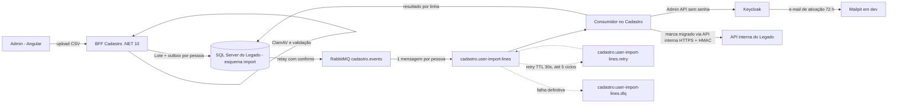
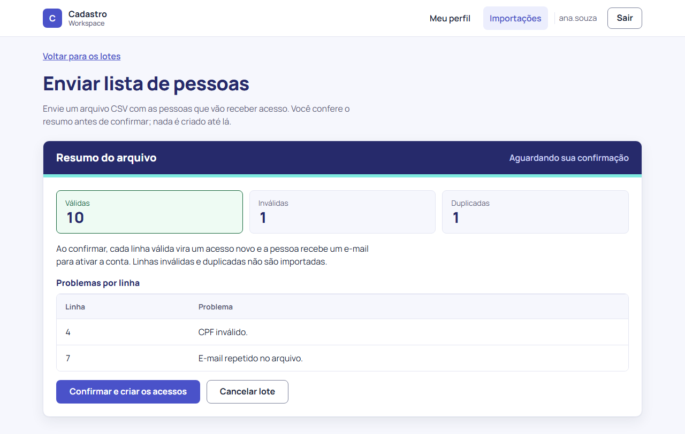
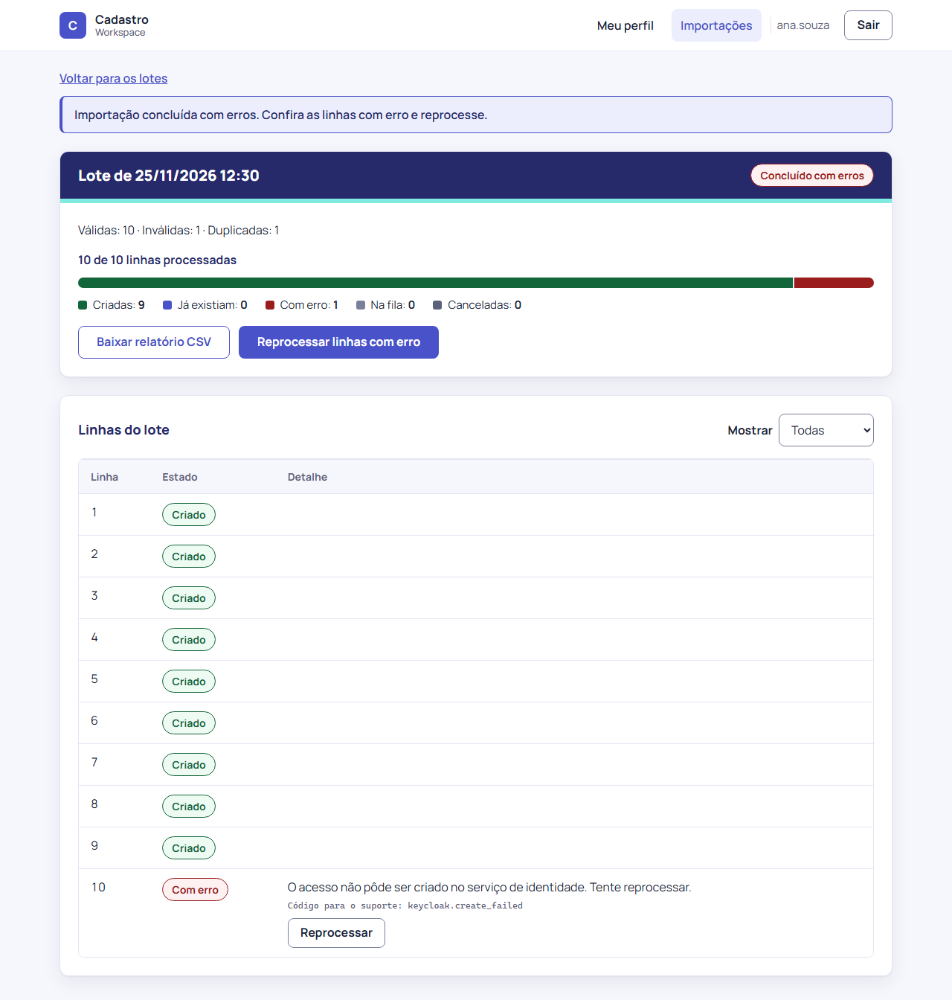
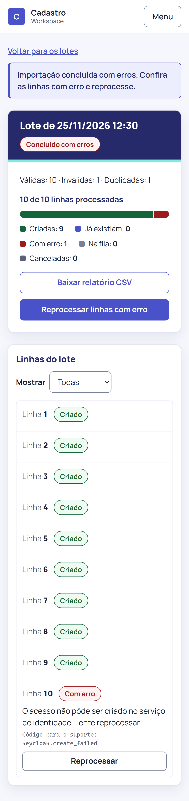

# Importação em lote de usuários

Como o Cadastro cria centenas ou milhares de acessos a partir de uma planilha CSV, sem senha em trânsito, sem perder nem duplicar
ninguém e sem dado pessoal em log. Este documento serve a quem entra no projeto e a quem quer entender as decisões de engenharia.

Detalhes de implementação e regras que não podem regredir: [reference.md](reference.md) · decisões: [ADR-0007](adr/0007-esquema-import-no-banco-do-legado.md),
[ADR-0009](adr/0009-consumidor-no-processo-da-api.md) · especificação e plano (repositório `rabbitmq`): `docs/specs/002-uso-pelos-projetos/`.

## O problema

Um administrador recebe uma lista de pessoas (nome, e-mail, CPF, telefone) e precisa dar acesso a todas. Fazer à mão é lento e sujeito a erro;
criar uma senha para cada pessoa e enviá-la por e-mail é inseguro. A importação resolve assim:

- o admin envia o CSV, vê um **resumo antes de qualquer efeito** (válidas, inválidas, duplicadas) e só então confirma;
- cada pessoa vira **uma mensagem** na fila e o usuário é criado no Keycloak **sem senha**, com a ação obrigatória "definir senha" e um e-mail
  de ativação com link válido por **72 h**;
- o resultado de cada linha fica num relatório; falhas definitivas podem ser **reprocessadas** com um clique;
- quem já existia no Legado (mesmo e-mail) é marcado como migrado, sem nunca criar conta duplicada.

## Fluxo



| Tela (desktop) | Resumo do arquivo antes de confirmar |
|---|---|
|  | O admin vê as contagens e os problemas por linha (só número da linha e código, nunca o valor). |

| Lote concluído com erros (desktop) | Lote concluído com erros (mobile) |
|---|---|
|  |  |

As telas acima são capturas reais da interface com dados fictícios (mocks), não um GIF.

## Decisões-chave

| Decisão | Por quê |
|---|---|
| **Uma mensagem por pessoa (1x1)** | Uma linha ruim não derruba o lote; retry e DLQ por pessoa; paralelismo controlado (prefetch 10). |
| **Transactional Outbox** | Confirmar o lote grava uma linha de outbox por pessoa **na mesma transação**; um relay publica com publisher confirms. Sem dual write: nem perda, nem mensagem fantasma. |
| **Consumidor idempotente (inbox)** | A entrega é "pelo menos uma vez". O `messageId` entra na inbox na mesma transação do efeito; repetição vira ack sem efeito. Falha transitória volta pela fila de retry (30 s, até 5 ciclos); definitiva vai à DLQ com a linha marcada com um código. |
| **Sem senha** | O usuário nasce com `UPDATE_PASSWORD` e recebe um link de ativação (sempre `?lifespan=259200`). Nenhuma senha trafega, é logada ou chega por e-mail. |
| **LGPD** | Nome, e-mail, CPF e telefone ficam cifrados no banco (AES-256-GCM) e são apagados quando a linha termina (criada ou já existente). A mensagem do broker leva só `batchId` e `lineId`. Logs só com ids e códigos. Linha com erro mantém os dados cifrados para o reprocessamento, até a retenção. |
| **Só o criador altera o lote** | Confirmar, cancelar e reprocessar exigem o mesmo `sub` que enviou o arquivo; os demais `user-importer` só leem. Acesso exige a role `user-importer` e OTP recente. |
| **Confirmação em 2 passos** | O token do resumo é um HMAC do que o admin viu (hash do arquivo, contagens, lote e `sub`): não dá para confirmar um lote diferente do exibido. |
| **Privilégio mínimo** | O broker (`cadastro-app`) só lê a fila e escreve em `cadastro.events` e `cadastro.retry`, nunca declara topologia. O client `cadastro-importer` do Keycloak só cria usuário e envia o e-mail. O banco usa dois logins (`cadastro_app` sem DDL, `cadastro_migrator` só nas migrations). |
| **Marcação no Legado nunca desfaz o Keycloak** | Só com um candidato de e-mail exatamente igual; zero é "sem candidato", vários é aviso, API fora vira `Failed` na linha. |

## Como rodar do zero

Pré-requisitos: Docker, .NET 10 SDK e os repositórios irmãos `keycloak`, `rabbitmq` e `legado-cadastro-usuarios` ao lado deste. Ordem validada no E2E real:

1. **Redes**: `workspace-identity` e `workspace-data` (scripts `identity-network.sh` e `data-network.sh` do Legado); `workspace-messaging` já existe com o RabbitMQ.
2. **Legado** (`legado-cadastro-usuarios`): `./scripts/internal-credentials.sh` (CA, certificado, chaves HMAC e senhas dos logins SQL) e
   `docker compose -f docker-compose.yml -f docker-compose.identity.yml -f docker-compose.data.yml up -d --build` (o migrator cria o esquema `import` e os logins).
3. **Keycloak**: de pé e provisionado (client `cadastro-importer`, role `user-importer`, atributo `importLineId`, SMTP do Mailpit).
4. **RabbitMQ**: de pé e **provisionado** (exchanges, filas, policies e o usuário `cadastro-app`).
5. **Cadastro**, nesta pasta:
   ```bash
   ./scripts/generate-env.sh          # .env: segredos copiados do Keycloak, RabbitMQ e Legado; chaves geradas aqui
   ./scripts/identity-network.sh
   ./scripts/migrate-import-db.sh     # migrations do esquema import (login cadastro_migrator)
   docker compose -f docker-compose.yml -f docker-compose.data.yml -f docker-compose.messaging.yml -f docker-compose.import.yml up -d --build
   ```
   O ClamAV sobe junto no compose do Cadastro. O consumidor só liga com `ImportConsumer:Enabled=true`, que o `docker-compose.import.yml` já define.
6. Abra `http://localhost:4300`, entre com um usuário com a role `user-importer` (e OTP) e use **Importação em lote**.

Os testes automatizados não exigem nada disso (Testcontainers): `dotnet test --solution Cadastro.slnx`.

## Formato do CSV

Cabeçalho exato `nome,email,cpf,telefone`, UTF-8, até 5 MB e 5.000 linhas. Telefone é opcional. O CPF pode vir formatado.
O arquivo para baixar na tela de envio é `cadastro-frontend/public/exemplos/usuarios-exemplo.csv` (só linhas válidas). Para ver os erros acontecerem, use
[`examples/usuarios-com-linhas-invalidas.csv`](examples/usuarios-com-linhas-invalidas.csv): 3 linhas válidas, 3 inválidas (e-mail, CPF e nome com caractere proibido) e 1 duplicada.

```csv
nome,email,cpf,telefone
Ana Souza,ana.souza@example.com,529.982.247-25,(11) 91234-5678
Bruno Lima,bruno.lima@example.com,111.444.777-35,
Diego Rocha,email-sem-arroba,529.982.247-25,
Elisa Prado,elisa.prado@example.com,111.111.111-11,
<Fabio> Alves,fabio.alves@example.com,111.444.777-35,
```

O nome não pode ter os caracteres que o Keycloak recusa (`< > & " $ % ! # ? § ; * ~ / \ | ^ = [ ] { } ( )`): a linha vira inválida no upload
(`row.name_invalid`), antes de confirmar. O nome é dividido no primeiro espaço: o **primeiro nome aceita até 100 caracteres** e o **sobrenome (o resto) até 150**, os limites do perfil do Keycloak; acima disso a linha também é inválida no upload. Acentos, apóstrofo, hífen e ponto são aceitos.

## Códigos de erro e o que fazer

**Arquivo (resposta do upload)**

| Código | Significa | O que fazer |
|---|---|---|
| `file.header_invalid` | Cabeçalho diferente de `nome,email,cpf,telefone` | Corrigir o cabeçalho. |
| `file.too_large` / `file.too_many_lines` | Mais de 5 MB ou 5.000 linhas | Dividir em arquivos menores. |
| `file.infected` | O antivírus encontrou ameaça | Não enviar; verificar a origem do arquivo. |
| `scanner.unavailable` | ClamAV fora do ar (o upload falha fechado) | Tentar de novo depois; chamar a operação se persistir. |
| `import.no_valid_lines` | Nenhuma linha válida | Ver os problemas por linha e corrigir. |
| `import.duplicate_file` | O mesmo arquivo já foi enviado (409) | Abrir o lote existente, em vez de reenviar. |
| `import.not_owner` | Só quem enviou o lote altera | Pedir a quem enviou. |

**Linha do arquivo (`row.*`, só o número da linha e o código):** `name_required`, `name_invalid`, `email_required`, `email_invalid`, `cpf_required`,
`cpf_invalid`, `phone_invalid`, `duplicate_email`, `duplicate_cpf`, `malformed`, `field_too_long`. Corrija a linha e reenvie o arquivo.

**Linha processada com erro (`failureReason` no relatório)**

| Código | Significa | O que fazer |
|---|---|---|
| `identity.rejected` | O Keycloak recusou os dados (ex.: primeiro nome com mais de 100 caracteres) | Corrigir o dado na origem e enviar de novo. |
| `identity.activation_email_rejected` | O Keycloak recusou o envio do e-mail de ativação | Conferir o e-mail e **Reprocessar**. |
| `processing.retries_exhausted` | Falha transitória por mais de 5 ciclos | Resolver a causa (Keycloak, banco) e **Reprocessar**. |
| `processing.failed` | Falha inesperada ao processar ou publicar a retry | **Reprocessar**; se repetir, chamar a operação. |
| `personal_data.unavailable` | Os dados pessoais já foram apagados ou não decifram | Reenviar a linha em novo arquivo. |
| `line.not_found`, `batch.invalid_state`, `message.invalid`, `db.concurrency_conflict` | Inconsistência interna | Chamar a operação com o id do lote. |

Falha de credencial do importador (segredo errado, role removida) **não** vira erro de linha: as mensagens esperam sem gastar tentativas até alguém corrigir (ADR-0009).

## Limites

5 MB e 5.000 linhas por arquivo · **10 criações por segundo** (protege a Admin API do Keycloak) · link de ativação válido por **72 h** ·
relatório por linha retido por 90 dias e auditoria por 12 meses · prefetch 10 mensagens por vez.

### Retenção (job de limpeza)

Um serviço em segundo plano da API (`ImportRetentionService`) roda a cada 6 h e apaga, em lotes de 500:

- **Lotes com o relatório vencido** (90 dias após o fim do lote). As linhas saem em cascata, inclusive os **dados cifrados das linhas que terminaram em erro** e ficaram guardadas para o reprocessamento.
- **Registros de auditoria** com mais de 12 meses.

Lote ainda em processamento (sem prazo) nunca é apagado. Reprocessar um erro reabre o lote e zera o prazo, que recomeça quando ele termina de novo. O job é idempotente e registra só contagens no log (nunca dado pessoal).

Configuração (`ImportRetention:*`): `Enabled` (padrão `true`), `IntervalMinutes` (360), `InitialDelaySeconds` (60) e `BatchSize` (500). Lotes abandonados em *aguardando confirmação* não vencem por este job (ver Riscos).

## Resultado do E2E real

Stack real, sem mocks e sem Testcontainers; dados 100% fictícios. Execução de referência: 11 testes, todos passaram, 13,6 min
(relatório completo em `docs/specs/002-uso-pelos-projetos/e2e-report.md` do repositório `rabbitmq`).

| Verificação | Resultado |
|---|---|
| Lote de 5.000 linhas (4.950 válidas, 20 inválidas, 30 duplicadas) | Resumo na tela igual ao da API; nada no broker antes de confirmar |
| Processamento | 504 s, vazão de 9,94 criações/s; estado final `Completed`: 4.950 criadas, 0 erro, 0 pendentes |
| Keycloak | 4.950 usuários com `importLineId` distinto; 0 com senha; 0 sem `UPDATE_PASSWORD` |
| E-mail de ativação | 4.950 e-mails, 0 destinatário repetido, validade do link exatamente 259.200 s (72 h) |
| Reenvio do mesmo arquivo | `409 import.duplicate_file`, nenhum usuário novo |
| Idempotência | Mensagem republicada com o mesmo `messageId`: nenhum efeito novo |
| Resiliência (Keycloak parado ~36 s no meio do lote de 400) | 397 criadas, 3 com erro definitivo, sem duplicata e sem destinatário sem e-mail |
| LGPD | 0 ocorrências de e-mail, CPF ou nome em ~70 MB de logs, em 5.708 mensagens AMQP, na DLQ, no esquema `import` e no relatório CSV (com controle positivo) |
| Marcação no Legado | 2 logins de e-mail igual marcados com o id do Keycloak; o de controle não foi marcado |

Observação: esse E2E plantou `<Rejeitado>` no nome para provocar a falha definitiva. Hoje esse caractere e nomes acima de 100/150 caracteres são barrados já no upload; o cenário do E2E foi
ajustado para um e-mail com ponto duplo (`imp..<id>@...`), que o upload aceita e só o Keycloak recusa (400 `error-invalid-email`). Reexecutado em 2026-11-26: com esse gatilho as linhas rejeitadas viraram erro definitivo e chegaram à DLQ (conferido), mas o E2E **não fechou 11/11**: com o realm de teste em ~31 mil usuários (cada rodada acrescenta ~5,4 mil) apareceram e-mails de ativação repetidos (1 no cenário de resiliência e 7 no lote grande), o risco aceito de reenvio quando uma tentativa estoura o tempo. Os testes H6, LGPD e métricas não rodaram depois dessa falha. A falha definitiva também é
coberta pelo teste de integração `Consumer_WhenKeycloakRejectsTheUser_DeadLettersAtOnceAndTheBatchStillCompletes`.

## Riscos conhecidos

- **OTP recente em todas as chamadas**: acompanhar um lote de ~8 min pede OTP novamente (a policy vale também para leitura). Decisão de produto pendente.
- **Banco compartilhado** com o Legado (exceção ao Art. III.4, ADR-0007), com plano de saída; a rede `workspace-data` é compartilhada.
- **E-mail na query da Admin API** (`GET users?email=`): conferir/mascarar o access log do Keycloak e de qualquer proxy antes de produção.
- **E-mail repetido** possível na retomada de uma linha (mensagem nova para a mesma linha) enquanto a pessoa não ativou.
- **Não verificado na stack real**: os 5 ciclos de retry esgotados, `AlreadyExists`, ambiguidade e indisponibilidade do Legado (cobertos por testes de integração), Graylog.
- **Lote abandonado em *aguardando confirmação*** mantém as linhas cifradas até alguém confirmar ou cancelar: não há prazo para ele no job de retenção (decisão pendente).
- Pendências de produção: painel/alerta de DLQ (O1), TLS validado no SQL Server.
- **Fora deste repositório**: o card do projeto no site principal ainda precisa ser atualizado.
